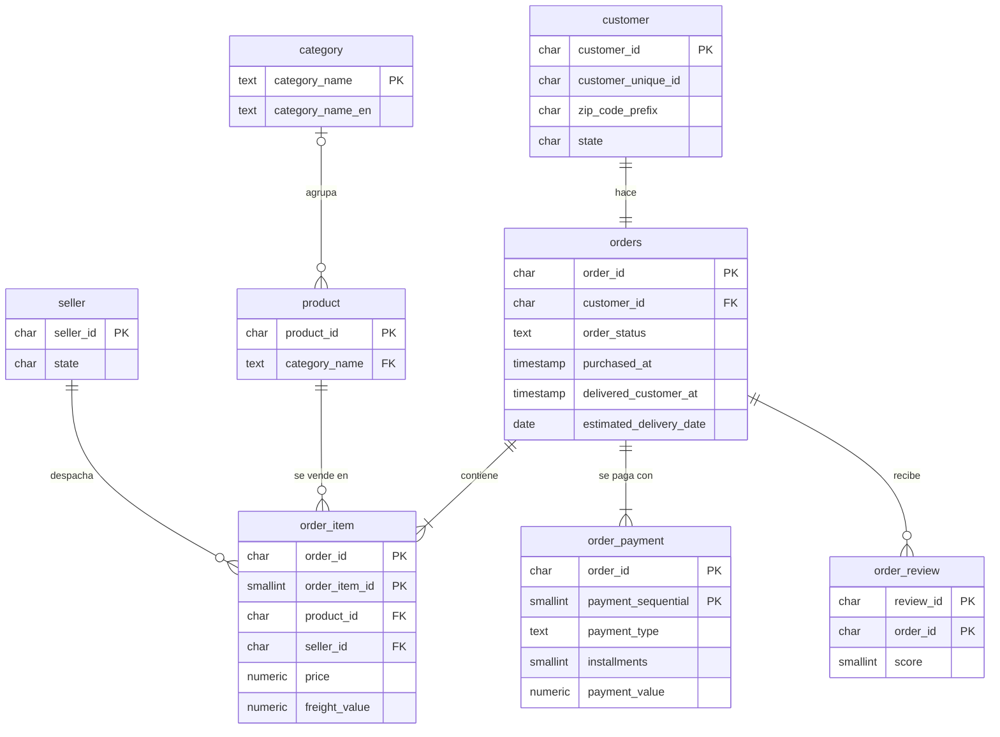
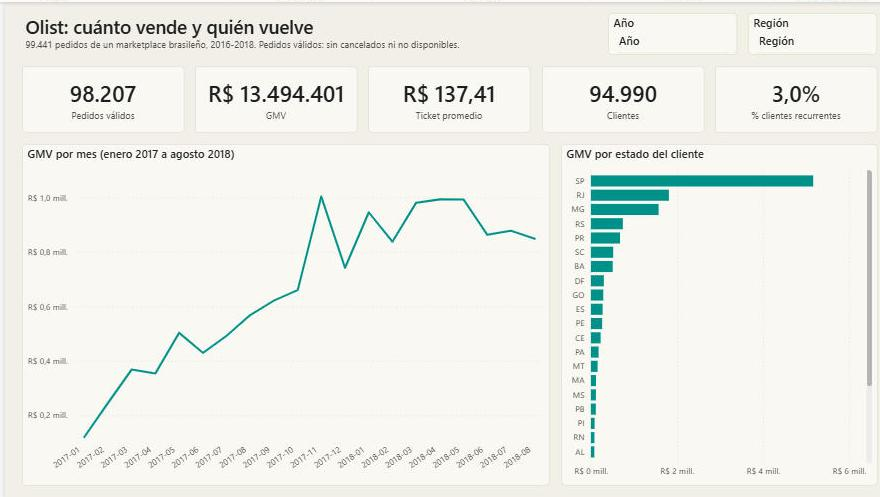
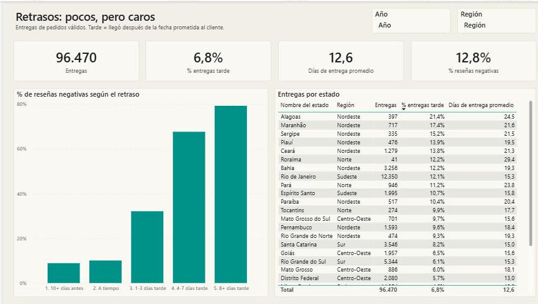
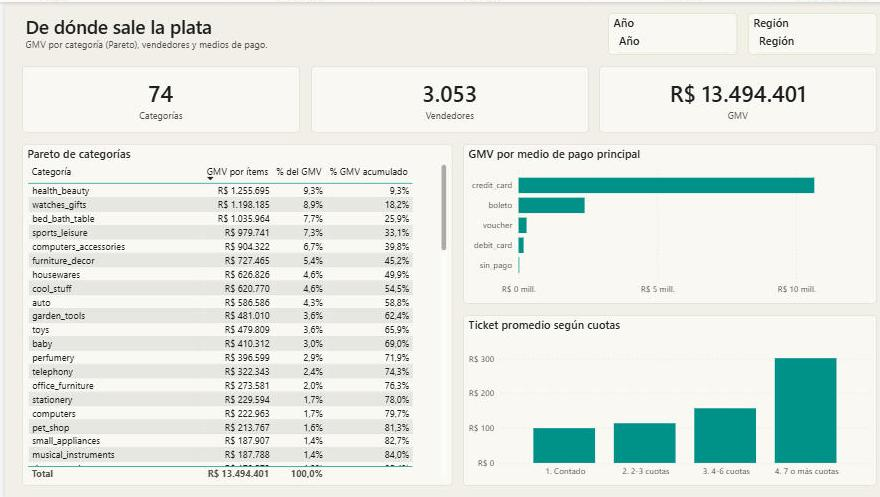

# Olist: análisis de e-commerce con PostgreSQL

Tomé el dataset público de Olist, un marketplace brasileño con 99.441 pedidos reales entre 2016 y 2018, lo cargué en PostgreSQL y le hice las preguntas que le haría el dueño de una tienda online: cuánto vende, quién vuelve a comprar, cuánto le cuestan los retrasos y de dónde sale la plata.

**Dashboard en vivo:** https://jorvalfe6-byte.github.io/olist-sql-analytics-demo/

El dashboard es una sola página estática. Lee un JSON de 24 KB con resultados ya agregados y dibuja los gráficos sin librerías externas.

**Informe de Power BI:** el mismo análisis en un informe de 3 páginas, en [`powerbi/`](powerbi/) ([más abajo](#informe-de-power-bi)).

## Lo que encontré

- **El negocio creció rápido y después se estabilizó.** El GMV mensual pasó de R$ 120 mil en enero de 2017 a R$ 1,0 millón en noviembre del mismo año (Black Friday). En 2018 se movió entre R$ 838 mil y R$ 994 mil por mes.
- **Casi nadie vuelve a comprar.** Solo el 3,0 % de los 94.990 clientes hizo más de un pedido, y en ninguna cohorte vuelve más del 0,71 % en un mismo mes. Para mí este es el problema principal del negocio, por encima de cualquier otro número de esta lista.
- **Los retrasos son pocos, pero salen caros.** El 6,8 % de las entregas llegó después de la fecha prometida. Cuando el pedido llega a tiempo, el 10,1 % de las reseñas es negativa (1 o 2 estrellas). Con 4 a 7 días de retraso sube al 67,7 %, y con 8 días o más, al 79,3 %.
- **El nordeste es donde más se falla.** Alagoas tiene 21,4 % de entregas tarde y Maranhão 17,4 %. São Paulo, que concentra 40.494 de las 96.470 entregas, está en 4,5 %.
- **Las ventas están concentradas.** 18 de 74 categorías hacen el 80 % del GMV, y el 10 % de los vendedores vende el 67,5 %.
- **La tarjeta de crédito mueve el 78,5 % del dinero.** Y entre más cuotas, más alto el pago: R$ 96 en promedio por pago de contado contra R$ 332 en 7 cuotas o más.

## Cómo está armado

```
CSV ──\copy──▶ staging ──transform──▶ core ──▶ mart ──▶ dashboard.json ──▶ docs/index.html
(texto crudo)    (todo TEXT)    (tipado, PK/FK/CHECK)  (vistas)   (solo agregados)
                                      │
                                      └──▶ audit.load_log (filas leídas vs. cargadas)
```

| Capa | Qué hace |
|---|---|
| `staging` | Recibe los 8 CSV tal cual, todo como texto. Así la carga no se cae por un formato raro y los errores aparecen después, en un lugar donde se pueden revisar. |
| `core` | Modelo tipado con claves primarias, foráneas, `CHECK` y `NUMERIC` para el dinero. La transformación corre en una sola transacción y es idempotente (se puede repetir sin duplicar nada). |
| `audit` | Una fila por tabla en cada carga: cuántas filas entraron y cuántas quedaron. |
| `mart` | `fact_order` (vista materializada, una fila por pedido) y `fact_item` (una fila por ítem). Toda la analítica sale de aquí. |

### Modelo de datos



## Las consultas

Cada archivo de `sql/analysis/` se puede correr por separado, y en el encabezado dice qué representa cada fila del resultado.

| Archivo | Qué responde | Técnicas |
|---|---|---|
| `00_calidad_datos.sql` | ¿La carga quedó completa? | 9 controles contra los totales del dataset original |
| `01_kpis_generales.sql` | Resumen ejecutivo | `PERCENTILE_CONT`, `FILTER`, ventana para contar recompras |
| `02_ventas_mensuales.sql` | Tendencia mensual | Calendario con `generate_series`, `LAG` para MoM y YoY, acumulado anual, media móvil |
| `03_cohortes_retencion.sql` | ¿Vuelven los clientes? | Cohortes por mes de primera compra |
| `04_rfm_segmentacion.sql` | ¿Qué clientes valen más? | RFM con quintiles por `CUME_DIST` (deterministas ante empates) y reglas fijas donde los quintiles no sirven |
| `05_logistica_entregas.sql` | ¿Dónde fallan las entregas y qué cuesta? | `GROUPING SETS` para el total nacional, percentil 90 |
| `06_categorias_pareto.sql` | ¿Qué categorías importan? | Curva ABC con suma acumulada |
| `07_vendedores_ranking.sql` | Mejores vendedores por estado | Top-N por grupo con `ROW_NUMBER`, `PERCENT_RANK` |
| `08_pagos.sql` | Medios de pago y cuotas | Pivot con `FILTER` |

## Decisiones y problemas que encontré en los datos

- **El cliente real es `customer_unique_id`, no `customer_id`.** Olist le da un `customer_id` nuevo a cada pedido. Si se cuenta por esa columna, parece que nadie repite nunca. Por eso todo lo de clientes usa `customer_unique_id` (96.096 personas).
- **`review_id` no es único.** Hay 814 repetidos, porque la misma encuesta quedó asociada a varios pedidos. La clave primaria es `(review_id, order_id)`, y cuando un pedido tiene más de una reseña se toma la más reciente.
- **Ítems y pagos se agregan antes del JOIN.** Si se unen crudos con el pedido, uno con 3 ítems y 2 pagos queda en 6 filas y el monto sale duplicado. En `fact_order` cada lado se resume en su propia CTE.
- **Dos categorías no tenían traducción** (`pc_gamer` y `portateis_cozinha_e_preparadores_de_alimentos`). Las agregué en la transformación para no romper la clave foránea, y quedan registradas aparte en la auditoría.
- **Las fechas no traen zona horaria.** Por eso uso `TIMESTAMP` y no `TIMESTAMPTZ`: prefiero dejarlo dicho a inventar un desfase.
- **Pedido válido** es todo pedido que no esté cancelado ni marcado como no disponible. Quedan 98.207.
- **Lo que no se cargó:** la tabla de geolocalización (coordenadas por código postal). Para los análisis por estado no hace falta, porque clientes y vendedores ya traen el estado y la ciudad.

## Informe de Power BI

Además del dashboard web, el repo trae un informe de Power BI en `powerbi/` con el mismo análisis, para filtrarlo por año y región sin tocar SQL.







| Página | Qué responde |
|---|---|
| Resumen | Pedidos, GMV, ticket promedio, clientes y % de recurrentes; GMV por mes y por estado |
| Logística | % de entregas tarde y días de entrega por estado; reseñas negativas según los días de retraso |
| Categorías y pagos | Pareto de categorías (GMV, % y % acumulado), GMV por medio de pago y ticket según cuotas |

**Cómo está hecho.** `sql/06_powerbi_views.sql` arma un esquema `powerbi` en estrella encima de los marts: dos tablas de hechos (`fact_pedido`, un pedido por fila, y `fact_item`, un ítem por fila) y tres dimensiones (calendario continuo, estado con su región y categoría). `scripts/export_powerbi.sh` guarda cada vista como CSV en `powerbi/data/`, y el informe lee esos CSV. Por eso se abre sin PostgreSQL.

El proyecto está en formato PBIP: el modelo en TMDL y el informe en PBIR, todo texto, así que los cambios se ven en un diff como cualquier otro archivo del repo. Las medidas usan las mismas definiciones del resto del proyecto (pedido válido, GMV sin flete, cliente = `customer_unique_id`). Las validé contra las consultas SQL: 94.990 clientes, 3,0 % recurrentes, 6,8 % de entregas tarde, 18 de 74 categorías hacen el 80 % del GMV, y las reseñas negativas suben de 10,1 % a tiempo a 79,3 % con 8 días o más de retraso.

**Para abrirlo** necesitas Power BI Desktop (gratis, solo Windows). Abre `powerbi/Olist.pbip`. El parámetro `DataPath` apunta a la carpeta `powerbi/data/` de este repo en GitHub, así que basta con actualizar. Si prefieres leer los CSV de tu copia local, cambia `DataPath` en Transformar datos → Editar parámetros por la ruta de tu carpeta `powerbi\data\` (con la barra al final).

## Cómo correrlo

Necesitas PostgreSQL 14 o más reciente y `psql`.

1. Descarga el dataset de [Kaggle](https://www.kaggle.com/datasets/olistbr/brazilian-ecommerce) y descomprime los CSV en `data/`. Si no tienes cuenta en Kaggle, `./scripts/download_data.sh` baja los mismos 8 archivos desde el repositorio público de Olist en GitHub.
2. Crea la base y carga todo:

```bash
createdb olist
export PGDATABASE=olist          # más PGHOST / PGUSER si hace falta
./scripts/load.sh                # esquema, carga, transformación, vistas y controles
./scripts/export_dashboard.sh    # regenera docs/data/dashboard.json
./scripts/export_powerbi.sh      # regenera los CSV de powerbi/data/
```

En mi máquina la carga completa tarda unos 8 segundos. Al final imprime los controles de calidad, y todos deben decir `OK`: si alguno dice `REVISAR`, el script termina con error.

Cada push corre esta misma carga en GitHub Actions y compara el JSON exportado con el que está en el repositorio.

3. Para ver el dashboard en local:

```bash
python3 -m http.server --directory docs
```

## Estructura

```
sql/
  01_schema.sql            esquemas, tablas y restricciones
  02_load_staging.sql      \copy de los CSV
  03_transform.sql         staging → core, auditoría e índices
  04_marts.sql             fact_order y fact_item
  05_dashboard_views.sql   vistas que alimentan el dashboard
  06_powerbi_views.sql     modelo en estrella para Power BI (esquema powerbi)
  analysis/                consultas de análisis, una por pregunta
scripts/
  download_data.sh         baja los CSV desde el repositorio público de Olist
  load.sh                  carga completa de punta a punta
  export_dashboard.sh      exporta los agregados a JSON
  export_powerbi.sh        exporta el esquema powerbi a CSV
powerbi/
  Olist.pbip               proyecto de Power BI (abrir con Power BI Desktop)
  Olist.SemanticModel/     modelo: tablas, relaciones y medidas DAX (TMDL)
  Olist.Report/            páginas y visuales (PBIR)
  data/                    CSV que lee el informe
docs/
  index.html               dashboard (GitHub Pages)
  data/dashboard.json      resultados agregados
data/                      CSV originales (no se suben al repo)
```

## Licencias

- **Datos:** [Brazilian E-Commerce Public Dataset by Olist](https://www.kaggle.com/datasets/olistbr/brazilian-ecommerce), licencia [CC BY-NC-SA 4.0](https://creativecommons.org/licenses/by-nc-sa/4.0/). Los CSV originales no están en el repositorio. Los agregados de `docs/data/` y los CSV derivados de `powerbi/data/` (un pedido o un ítem por fila, con los mismos identificadores anónimos del dataset) se publican bajo la misma licencia, con atribución a Olist.
- **Código** (SQL, scripts y página): MIT, ver [LICENSE](LICENSE).

---

**Jorge Valencia**, automatizaciones y análisis de datos. Si tienes datos de tu negocio en hojas de cálculo o en un sistema que no te da reportes, este es el tipo de trabajo que hago.
